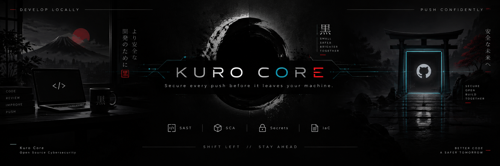
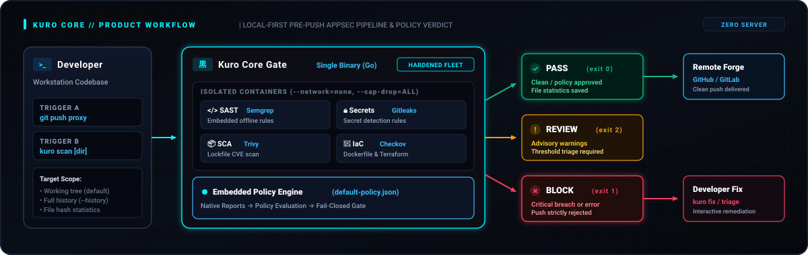
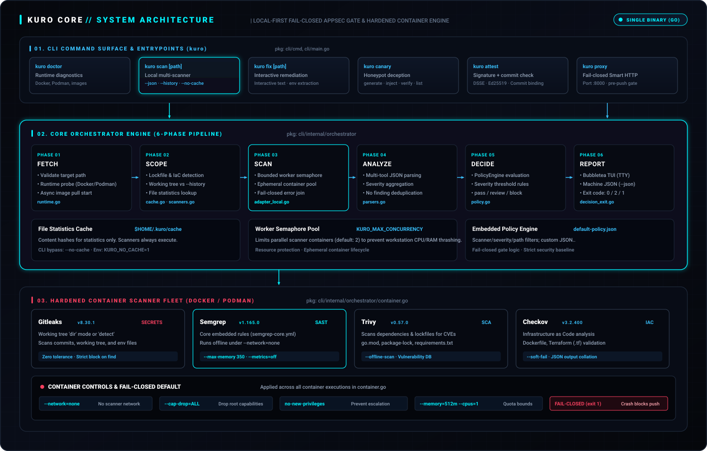
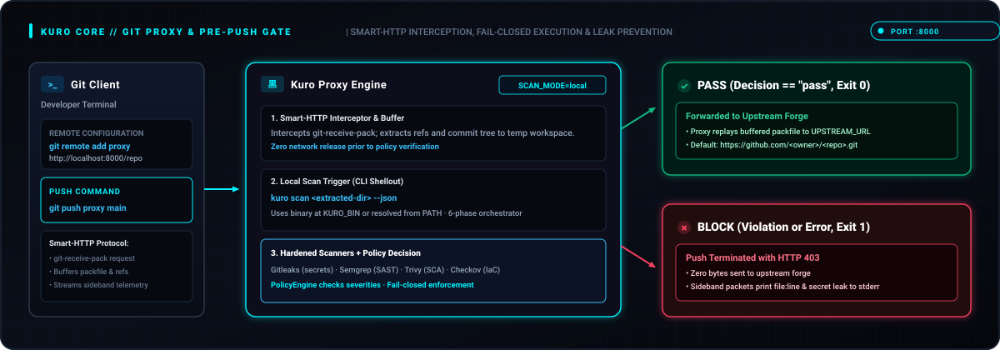

<div align="center">



# KURO CORE

**Local-First AppSec Gate**  
*Secure every push before it leaves your machine.*

[](https://github.com/Haiagari/kuro-core/actions/workflows/ci.yml)
[](https://github.com/Haiagari/kuro-core/actions/workflows/secret-scanning.yml)
[](https://github.com/Haiagari/kuro-core/releases)
[](https://go.dev)
[](LICENSE)

[Quickstart](QUICKSTART.md) • [Architecture](docs/ARCHITECTURE.md) • [Scanner Fleet](docs/SCANNER-ARCHITECTURE.md) • [CLI & API](docs/API.md) • [Contributing](CONTRIBUTING.md)

</div>

---

## What is Kuro Core?

**Kuro Core** (`黒`) is a single-binary security gate designed to stop credential leaks, code vulnerabilities, and insecure infrastructure code before source leaves the developer workstation.

Unlike centralized server platforms that require external infrastructure, Kuro Core runs entirely local-first. It coordinates industry-standard scanners (Gitleaks, Semgrep, Trivy, and Checkov) inside hardened, ephemeral containers with network-disabled scan containers, resource throttling, explicit offline database preparation, and deterministic exit codes.

**Documentation status:** this README describes the current development source, including unreleased changes. Use source build while [release assets](https://github.com/Haiagari/kuro-core/releases) are unavailable. It does not certify a published v0.1.1 binary.

<p align="center">
  
</p>

---

## Why Kuro Core?

- **Zero External Infrastructure** — Operates entirely on the workstation via Docker or Podman. No PostgreSQL, NATS, MinIO, or central orchestrators required.
- **Fail-Closed Security Gate** — Container errors, timeouts, or policy breaches strictly trigger `exit 1` (`decision: block`). No silent passes on scanner failure.
- **Pre-Push Git Proxy** — Native Smart-HTTP proxy intercepts `git push` on port `:8000`, materializes push data in temporary work directories for scanning, and rejects policy breaches before reaching upstream forges.
- **Hardened Execution Envelope** — Scanners execute with `--network=none`, `--cap-drop=ALL`, `no-new-privileges`, and bounded CPU/memory quotas.
- **Fresh Gate Decisions** — Source hashes provide file statistics only. Every scan runs the current applicable scanners and policy; cached approvals never bypass them.
- **Interactive Secret Remediation** — `kuro fix` provides a heuristic interactive text workflow to inspect and replace exposed credentials with environment variables across Go, Python, and JS/TS.
- **Canary Tokens & Attestation** — Generate synthetic HMAC-marked tokens (`kuro canary`) and verify an existing security-gate statement’s signature and commit binding (`kuro attest`). External monitoring and production attestation issuance are separate concerns.

---

## Quick Start

### 1. Installation

**Available path: build from source**

```bash
git clone https://github.com/Haiagari/kuro-core.git
cd kuro-core
make build
export PATH="$PWD/bin:$PATH"
# Optional system install: sudo make install
```

Prerequisites: Go **1.26.4+** for builds, Git, Make and Docker 24+ or Podman 4+. Release packaging targets Linux/macOS amd64/arm64. Windows/WSL behavior is not verified here.

For scans that select Trivy, prepare its vulnerability database in a separate online step:

```bash
./scripts/update-trivy-db.sh
```

No source is mounted during database download. Scan containers remain offline and reject missing/expired databases. See [scanner requirements](docs/SCANNER-ARCHITECTURE.md).

**Release installer (only when compatible assets exist):**

```bash
curl -fsSL https://raw.githubusercontent.com/Haiagari/kuro-core/main/scripts/install.sh | sh
```

See [Releases](https://github.com/Haiagari/kuro-core/releases) for published tags; a source version label is not a downloadable release. The installer checks SHA-256 and uses GoReleaser filenames without the tag’s leading `v`.

### 2. Verify Environment

```bash
kuro doctor
```

Validates container runtime health, scanner image availability, git binary, disk space, and Kuro version.

### 3. Run a Scan

```bash
# Interactive TUI mode on a TTY:
kuro scan ./my-project

# Machine-readable JSON output (flags work after path):
kuro scan ./my-project --json

# Disable optional file statistics (scanners always run):
kuro scan ./my-project --no-cache
```

### Deterministic Exit Codes

| Decision | Exit Code | Meaning |
| --- | --- | --- |
| `pass` | `0` | Applicable checks completed; active policy permits findings |
| `review` | `2` | Advisory findings detected; threshold review needed |
| `block` | `1` | Policy violation, secret leak, or scanner error |

### Validation kit

See the [demo walkthrough](docs/market-validation/DEMO.md) and [interview guide](docs/market-validation/INTERVIEW-GUIDE.md) for the Phase 0/1 validation materials.

---

## System Architecture

Kuro Core coordinates local analysis across a 6-phase pipeline: **Fetch → Scope → Scan → Analyze → Decide → Report**.

<p align="center">
  
</p>

### Pipeline Overview

1. **Fetch** — Resolves target paths, probes container engine (Docker daemon preferred, Podman fallback), and initiates asynchronous image pulls.
2. **Scope** — Detects lockfiles (`go.mod`, `package-lock.json`, `requirements.txt`) and IaC configurations (`Dockerfile`, `*.tf`). Checks differential cache.
3. **Scan** — Spawns isolated container scanners governed by a counting semaphore (`KURO_MAX_CONCURRENCY=2` by default) to protect system resources.
4. **Analyze** — Normalizes scanner JSON and aggregates findings; no finding deduplication is implemented.
5. **Decide** — Evaluates findings against embedded `rules/default-policy.json` (customizable via `KURO_POLICY_PATH`).
6. **Report** — Emits Bubbletea TUI output, summary text, or JSON envelopes with deterministic process exit codes.

For detailed internals, see [docs/ARCHITECTURE.md](docs/ARCHITECTURE.md).

---

## Scanner Fleet & Hardening

Every scanner runs in a strictly confined container sandbox defined in [`cli/internal/orchestrator/container.go`](cli/internal/orchestrator/container.go):

| Scanner | Pinned Version | Layer | Runtime Hardening |
| --- | --- | --- | --- |
| **Gitleaks** | `v8.30.1` | Secrets | `--network=none`, `--cap-drop=ALL`, `:ro,Z` mount |
| **Semgrep** | `v1.165.0` | SAST | Embedded `semgrep-core.yml`, `--max-memory 350`, offline |
| **Trivy** | `v0.57.0` | SCA (Deps) | Prepared DB cache; offline scan; missing/stale DB blocks |
| **Checkov** | `v3.2.400` | IaC | `--soft-fail`, isolated container execution |
| **TruffleHog** | `v3.81.0` | Deep Secrets | Optional history mode (`kuro scan --history`) |

### Isolation Constraints

```text
docker|podman run --rm
  --network=none                     # Disable scan container networking
  --cap-drop=ALL                     # Drop all Linux root capabilities
  --security-opt=no-new-privileges   # Prevent privilege escalation
  --memory=512m --cpus=1.0           # Host resource caps per container
  -v <host_path>:<mount>:ro,Z        # Read-only source with SELinux relabeling
```

For offline ruleset details and container mounts, see [docs/SCANNER-ARCHITECTURE.md](docs/SCANNER-ARCHITECTURE.md).

---

## Local Git Proxy (Pre-Push Gate)

The built-in Smart-HTTP proxy blocks insecure pushes before commits reach your remote repository:

<p align="center">
  
</p>

### Running the Proxy

```bash
# Start proxy in-process on :8000
KURO_BIN="$PWD/bin/kuro" ./bin/kuro proxy --addr 127.0.0.1:8000

# Configure git remote:
git remote add proxy http://localhost:8000/<owner>/<repo>.git
git push proxy main
```

- **Clean Push (`PASS`)** — Proxy transparently streams the buffered packfile to the upstream forge (default: `https://github.com`).
- **Policy Violation (`BLOCK`)** — Push is immediately terminated with HTTP 403 Forbidden. Sideband error packets report offending files and line numbers directly to your terminal stderr. Rejected receive-pack payloads are not forwarded under the default fail-closed configuration.

Configuration variables:

- `LISTEN_ADDR` (default `:8000`, `--addr` flag)
- `UPSTREAM_URL` (default `https://github.com`, `--upstream` flag)
- `SCAN_MODE` (default `local`, executes `kuro scan --json`)
- `KURO_BIN` (path to CLI binary, defaults to `kuro` on `PATH`)

---

## Core vs Enterprise

| Dimension | Kuro Core (`Haiagari/kuro-core`) | Kuro Enterprise (`Haiagari/kuro-enterprise`) |
| --- | --- | --- |
| **Deployment** | Single binary (`bin/kuro`) | Distributed server cluster |
| **Execution** | Local Docker / Podman containers | Firecracker MicroVMs / remote worker pool |
| **Datastores** | None (ephemeral / file cache) | PostgreSQL, NATS, MinIO, Redis |
| **Interface** | CLI, Bubbletea TUI, local proxy | Web dashboard, REST/gRPC API, webhooks |
| **Proxy Mode** | `SCAN_MODE=local` | `SCAN_MODE=api` (`KURO_URL` + `KURO_API_KEY`) |

*This repository contains Kuro Core. Server HTTP APIs, central audit dashboards, and multi-tenant management live in Kuro Enterprise.*

---

## CLI Quick Reference

```bash
# Diagnostics & Health
kuro doctor [--json]                                 # Validate runtime, images, tools
kuro version                                         # Display version string

# Security Scanning
kuro scan <path> [--json] [--no-cache] [--history]   # Local multi-scanner gate
kuro fix [path] [--dry-run] [--auto]                 # Interactive secret remediation

# Deception & Attestation
kuro canary generate [--type aws|github|slack|jwt]   # Generate honeypot tokens
kuro canary inject <dir> [--type ...]                # Inject canary credentials
kuro canary verify <token|file>                      # Verify canary legitimacy
kuro attest verify --pubkey key [--commit SHA]      # Verify signature + expected commit
kuro attest keygen                                   # Generate Ed25519 keypair

# Pre-Push Git Proxy
kuro proxy [--addr :8000] [--upstream URL]          # Start local pre-push proxy
```

A `pass` is limited to the selected scanners, rules, input and vulnerability database. History mode runs secret-history checks instead of working-tree SAST/SCA/IaC. The proxy is an opt-in route: direct pushes bypass it. Read-only mounts do not stop host edits during scans. Remediation does not revoke a leaked credential or erase Git history. See [architecture limits](docs/ARCHITECTURE.md).

Full CLI and output specifications: [docs/API.md](docs/API.md).

---

## Documentation

- [QUICKSTART.md](QUICKSTART.md) — Comprehensive first-time setup guide
- [docs/ARCHITECTURE.md](docs/ARCHITECTURE.md) — Detailed pipeline and proxy internals
- [docs/SCANNER-ARCHITECTURE.md](docs/SCANNER-ARCHITECTURE.md) — Scanner images, hardening, and offline execution
- [docs/POLICY.md](docs/POLICY.md) — Policy filters, precedence and mandatory safety floors
- [docs/API.md](docs/API.md) — JSON output schema and process exit code contracts
- [docs/ATTESTATION.md](docs/ATTESTATION.md) — Cryptographic provenance and verification
- [AGENTS.md](AGENTS.md) — Repository guidelines and constraints for automated assistants
- [CONTRIBUTING.md](CONTRIBUTING.md) — Development workflow, testing, and PR conventions
- [SECURITY.md](SECURITY.md) — Vulnerability reporting and security policies
- [CHANGELOG.md](CHANGELOG.md) — Release notes and version history

---

## License

Kuro Core is licensed under the [GNU Affero General Public License v3.0](LICENSE) (`AGPL-3.0-only`). See [NOTICE](NOTICE) for attribution and dependencies.

### Optional GitHub merge gate

See [Trusted Kuro PR Gate](docs/CI_GATE.md) for base-controlled CI scanning and activation as a required merge check. Its adoption policy blocks introduced findings and changes to affected files; unchanged existing findings remain counted debt. Installation alone does not activate branch enforcement.
